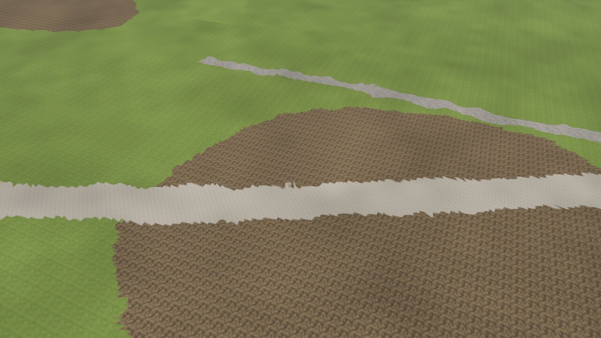
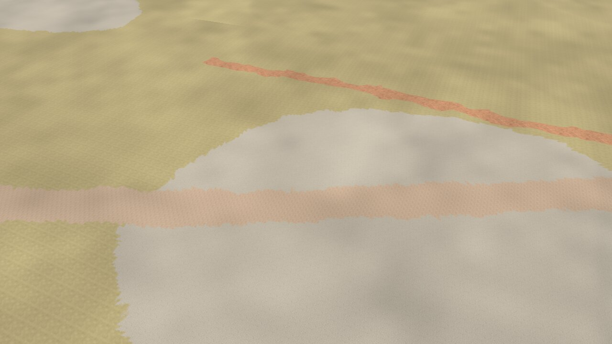
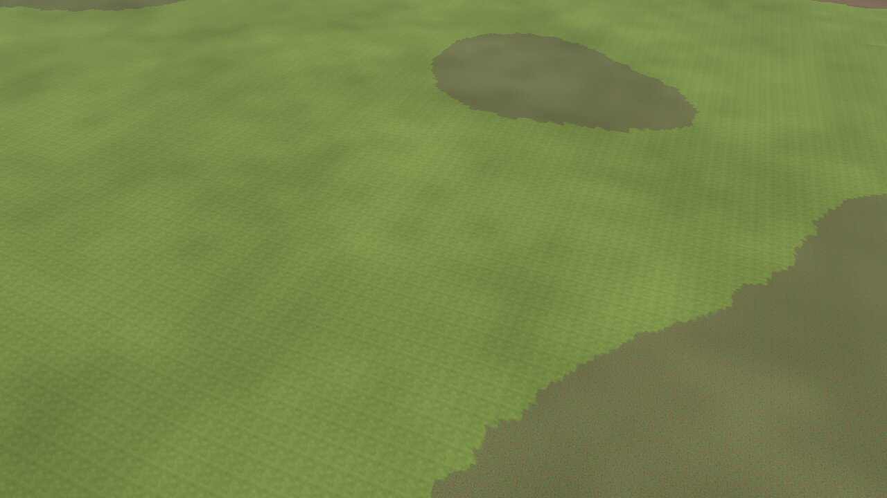
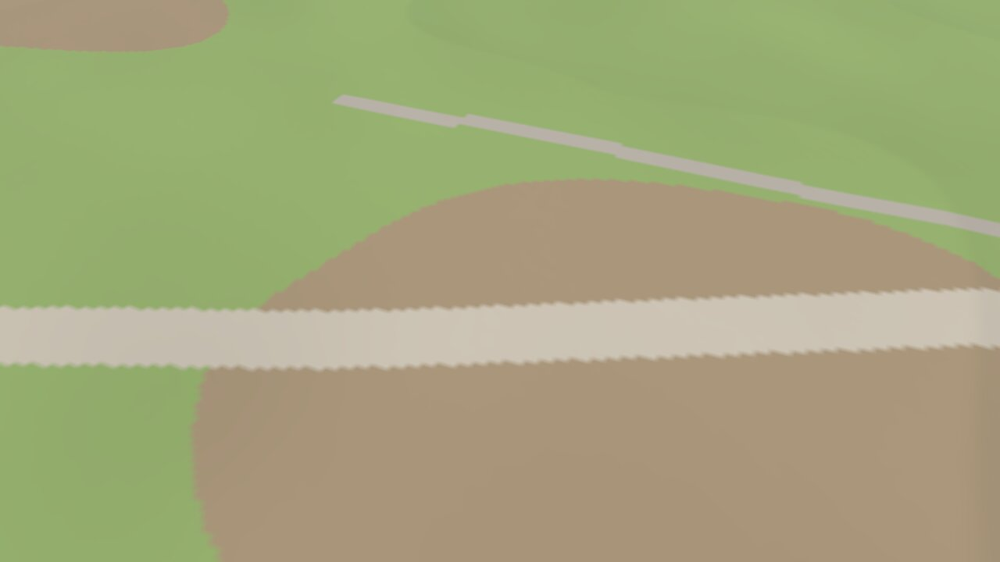
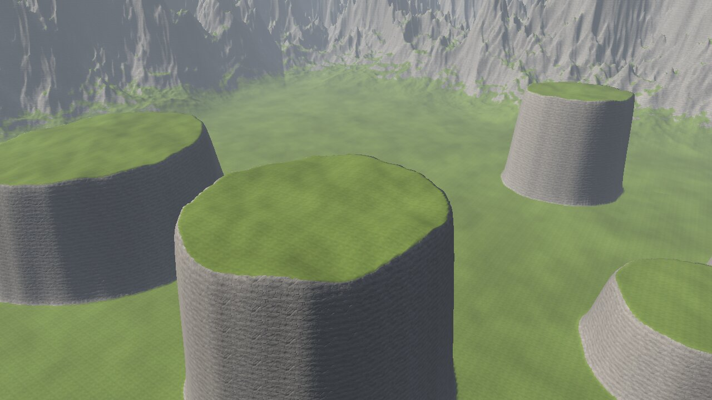
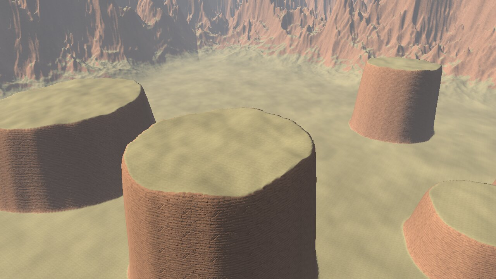
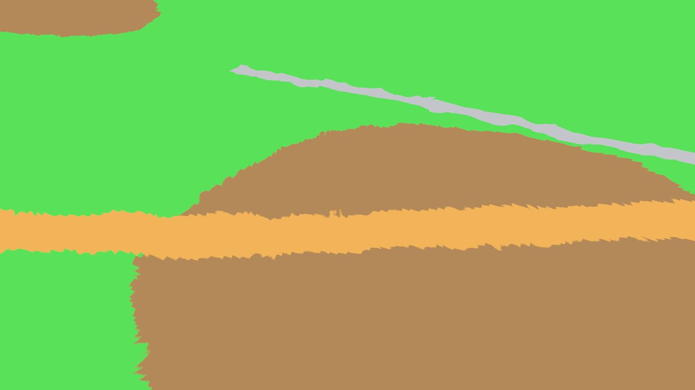

# Terrain material tilesets

How AssembleEngine colours terrain: reusable, per-environment surface libraries instead of
per-map colour and normal textures (MrBob's proposal, `docs/PLAN.md` "Terrain appearance").
This document is the M3 validation write-up the proposal asks for:
- the blending logic and where its shader code is;
- the tileset structure, with texture counts, sizes and formats;
- the engine inputs and controls;
- how tilesets are shared and replaced;
- the checks, the numbers, and what is not done.

Code:
- `crates/ae_render/src/terrain/tileset.rs`: data, procedural layers, uniform table;
- `crates/ae_render/shaders/terrain.frag`: the functions `project`, `groundTap`, `cliffTap`, `tileset`;
- `crates/ae_render/src/terrain/renderer.rs`: GPU upload and bindings 10–12.

## The idea

A map supplies only layout: its heightmap and per-cell gameplay materials (`ae_nav::terrain::Material`:
grass, forest, sand, rock, water bed, road, mud). A **tileset** supplies the look: a few tileable
surface layers, each with an albedo and a matching normal map. The terrain shader puts them together
per pixel from:
- the material cells;
- the surface orientation;
- the layers' own relief.

The same tileset therefore dresses any heightmap without repainting. Map creators own layout;
material artists own surface libraries. A new look replaces the textures and the table, not the
shader.

| Temperate on the water crossing map | The same map with the desert tileset |
|---|---|
|  |  |
| **Temperate on the land crossing map** | **The old per-material palette (`--tileset none`)** |
|  |  |
| **Cliffs, temperate (duoplanar rock)** | **Cliffs, desert (triplanar red rock)** |
|  |  |

The blend-weight debug view (`--weights` or B) shows each pixel's mix of layers as flat colours:

## Tileset structure

| Part | Contents |
|---|---|
| Layers | 1 to 8 (`MAX_LAYERS`). Both procedural sets have 7. |
| Albedo array | `R8G8B8A8_SRGB` 2D array, one array layer per tileset layer, full mip chain. RGB is albedo; A is the layer's height (0..1, linear: alpha is never sRGB-encoded). |
| Normal array | `R8G8_UNORM` 2D array with the same shape. Tangent-space normal x and y (z is reconstructed); x runs along the texture's u axis, y along v. |
| Size | Square, a power of two (`--tileset-size`, default 512). |
| Material table | Per gameplay material id (8 slots): a **ground** layer for flat ground and a **cliff** layer for steep slopes. |
| Per-layer settings | `tile_size`: world metres per repeat. `normal_strength`. `roughness`: the layer's GGX specular response (0 mirror, 1 matte; the procedural sets use 0.45 for wet beds and mud to 0.95 for forest floor). `projection`: `ByOrientation` (planar on ground, duoplanar on cliffs) or `Triplanar`. `directional`: the texture has a direction (strata, ripples), so anti-tiling shifts its copies instead of rotating them. |
| Per-tileset settings | `anti_tiling`: the degree of anti-tiling, 0..1 (0 samples each layer once, 1 uses 8 versions; see "Anti-tiling" below). `cliff_slope`: the slope range over which ground turns to cliff, as 1 − n.y; default 0.18..0.42, about 35°..55°. `blend_depth`: the sharpness of the height blend, default 0.22. `detail_tilt`: how much detail normals move the cliff mask, default 0.35. `warp`: boundary meander, default 2 cells with 40 m features. `macro_variation`: anti-tiling brightness, default ±22 % with 150 m features. |

**Memory.** One 512² layer is 512² × (4 + 2) bytes × 4/3 for mips = 2.0 MB. A 7-layer set is
14.0 MB, and the client prints the size at start-up. Generation of a procedural set is
multithreaded (layers in parallel, rows within each) and takes about 0.06 s on a 24-thread CPU.

**GPU side.** The renderer uploads both arrays once with `upload::image_layers` (2D-array views).
It uploads the table (`TilesetUbo`, 560 bytes, std140 with only 16-byte members, size asserted)
as a device-local uniform buffer. They are bound at set 0, bindings 10, 11 and 12 of the terrain
pipeline, sampled with a trilinear REPEAT sampler. Without a tileset the bindings hold 1×1
placeholders and the shader takes the palette path.

### The procedural placeholder sets

No texture source has been chosen yet, so the layers are generated. They use periodic gradient
noise and periodic cellular noise, so every layer tiles exactly, at every mip. Mips are 2×2 boxes:
albedo is averaged in linear light, normals as vectors and then renormalised.

| Slot (material) | `temperate` | `desert` |
|---|---|---|
| 0 grass | grass | dry scrub |
| 1 forest | forest floor (leaf litter) | dark scrub |
| 2 sand | rippled sand | dune sand |
| 3 rock (and every cliff) | grey rock with cracks and strata | red rock, triplanar |
| 4 water bed | pebbled river bed | cracked clay |
| 5 road | gravel | gravel |
| 6 mud | mud | salt pan |

To make another set, add a function like `temperate()`. To use real textures, fill the `Layer`
mips from image files. The renderer takes any `Tileset` that passes `validate()`.

## The shader: projection and blending

All of this is the `tileset()` function in `terrain.frag`. Inputs come from the vertex and the
existing terrain uniforms:
- the world position;
- the geometric normal: central differences of the height texture, as before;
- the cell position, which reads the material texture.

**Projection by orientation** (`project`, `groundTap`, `cliffTap`):
- **Ground layers:** sampled planar, from above. A `Triplanar` layer instead uses all three axes,
  weighted by |n|⁴.
- **Cliff layers:** sampled duoplanar, from the two horizontal axes weighted by |n.x|⁴ and |n.z|⁴,
  so steep faces are never stretched. A `Triplanar` cliff layer adds the top axis.
- **Normal signs:** each projection flips its u coordinate by the side the surface faces, and
  flips the tangent normal's x with it, so relief tilts the right way on faces pointing down
  either axis.
- **Combining normals:** tangent normals are combined with the geometric normal by a whiteout
  blend.
- **Gradients:** every sample uses `textureGrad` with world-position derivatives taken once at the
  top of `main`. The sampling can therefore branch without breaking mip selection.

**Two-level blending:**
1. **Broad masks.** The four material cells around the pixel give bilinear weights. The lookup
   position is first displaced by up to `warp` cells by a smooth value noise, so boundaries
   meander across cells instead of tracing the 8 m grid. The cliff mask is
   `smoothstep(cliff_slope, 1 − n.y)`. Its slope is taken from the geometric normal tilted towards
   the ground layers' detail normals (`detail_tilt`), so the pixel normals of the ground already
   break up where cliffs begin.
2. **Height blend.** The candidates are the four ground taps, weighted by their bilinear weight ×
   (1 − cliff), and the cliff tap, weighted by cliff. Each gets the score `layer height + weight`.
   Only candidates scoring within `blend_depth` of the best one survive, in proportion to how
   far above that floor they are. A layer whose texture is high at a pixel (a pebble, a rock
   ridge, a clump) wins there even with a lower broad weight. Boundaries become irregular and
   detailed, and follow the textures' own relief, rather than being a smooth line set by slope
   alone.

**Finishing.** The blended albedo is modulated by `macro_variation` (a broad brightness noise
against visible tiling), and the blended normal replaces the geometric one for lighting. Water
tint, fog and the LOD/wireframe overlays then apply as before.

**Anti-tiling** (`docs/antitiling.md`, after Quílez's "texture repetition", technique 3). The
tileset's `anti_tiling` degree (0..1) picks, per pixel, among `degree × 8` versions of a layer's
texture, each offset (and rotated, unless the layer is `directional`) by a seed; the degree also
scales each version's rotation and offset toward zero. The index is a smooth tiling noise (one
fetch from a generated 256² `R8_UNORM` texture at binding 20, 16 features, values spread evenly
over 0..1) read at 1/48 of the layer's uv, so its features span about 3 repeats. Two versions
blend only in the middle fifth of each index step, the transition pushed by their colour
difference so it follows the texture. The blend is re-centred on the layer's mean albedo and
height (from its last mip, in the table) and scaled to keep the contrast. Normals rotate back into
the uv frame. `directional` keeps a texture's direction (strata, ripples).

The degree is continuous: 0 samples once, 0.5 uses about 4 versions at half their rotation and
offset, 1 uses 8 at full. It is a tileset property, not a compile-time switch; the shader always
carries the path.

Defaults: both procedural sets use degree 1 for every layer (temperate: sand and rock
directional, the rest rotated; desert: dune sand and red rock directional, the rest rotated).

Measured from above (GPU test `anti_tiling_breaks_the_repeat_and_keeps_the_contrast`), the image's
correlation with itself one repeat away, above its correlation at 1.5 repeats: mud 0.56 → 0.02,
grass 0.41 → 0.11; at degree 0.1 the same measure is 0.21 and 0.25, so the knob is continuous.
Mean and standard deviation of luminance stay within 1 %. Cost of the terrain pass (bench,
1280×720, RTX 3060 Ti, against the same tileset at degree 0): close +45 µs (186.0 → 231.3),
overview +57 µs (239.6 → 297.0), cliffs +228 µs (503.0 → 730.7). The cliffs increase is mostly
the rock layer, which is anti-tiled too now that the degree belongs to the tileset.

**Cost control.** Where several corners share a layer, which is the case inside any material,
the shader samples it once. The cliff layer is sampled only where the cliff mask is above 0.
Taps are reused by constant index: a runtime index into the tap array cost 2–3× in GPU time.

## Engine inputs and controls

**API:**
- `TerrainApp::with_tileset(Arc<Tileset>)`. The tileset is separate from the map (`TerrainSource`)
  and optional; without it the terrain is drawn exactly as before.
- `TerrainView::tileset` (use it if present) and `TerrainView::weights` (the debug view).
- `tileset::by_name`, `temperate`, `desert`, `Tileset::validate`.

**`ae-client`:**
- `--tileset temperate|desert|none` (default temperate) and `--tileset-size N` (default 512).
- `--weights` starts in the weights view.
- **M** toggles between the tileset and the palette; **B** toggles the weights view.

Terrain edits from the sim (`--quake`) change material cells and heights. The tileset reads the
same material and height textures the edits update, so it should follow them; no test or capture
has looked at an edit under a tileset yet.

## Sharing and replacing tilesets

- **Shared:** one `Arc<Tileset>` can be given to any number of apps and maps, as in the water and
  land crossing captures above. A map never names texture files; it only has material ids.
- **Replaced:** a different tileset on the same map (`--tileset desert`) changes the whole look
  without touching the map or the shader. Within a tileset, the table re-points materials at
  layers, so two materials can share a layer, or a material can take another cliff.
- **Not yet:** swapping a tileset while running. The renderer uploads it when it is created.
  Replacing it at runtime would be the same kind of device-idle upload the terrain edits use.

## Checks and numbers

**Equivalence:** `--tileset none` gives byte-identical captures to before the change (water map
and generated map, 1280×720). The shader's palette path is textually unchanged; the tileset only
overrides its result.

**`cargo test -p ae_render --lib tileset`:**
- Every layer of both sets tiles. Across the wrap edge, the albedo, height and normal steps are
  no larger than 2.5× the average step inside, at mips 0–4. The measure does fail on a
  deliberately broken edge (`the_tiling_measure_sees_a_seam`).
- Normals are unit vectors, generation is deterministic, and broken tables are rejected.

**GPU test `tileset_boundaries_are_irregular_and_bounded`** (weights view, from straight above):
- A grass/sand material boundary meanders across 15 px (more than a cell, 11.4 px) and frays: 66
  of 232 rows jump 2+ px from the row before. It stays inside the band the warp allows around the
  cell boundary.
- With the palette, the same boundary is a straight line (spread 0).
- A ramp that steepens through the cliff thresholds shows rock where it is steep and grass on
  both flats, with an irregular edge (11 px spread).
- Removing the warp fails the test (spread 6), and so does removing the height blend (0 frayed
  rows). 0 validation messages.

**Windowed runs** with validation gave 0 validation messages:
- temperate with 10k units and a quake;
- desert in the weights view on the generated map;
- temperate under the `post` render module.

The M and B keys were not exercised in these runs (there is no key injection); the paths they
switch are the ones `--tileset none` and `--weights` run.

**GPU time of the terrain draw pass** (1280×720, RTX 3060 Ti, three runs each; the tileset
columns without anti-tiling, measured before it became a tileset degree):

| View | Palette | Temperate | Desert |
|---|---|---|---|
| Water map overview | 0.08 ms | 0.19 ms | 0.19 ms |
| Water map close-up | 0.05 ms | 0.17–0.18 ms | 0.18 ms |
| Generated map, cliffs | 0.08 ms | 0.34–0.38 ms | 0.34–0.36 ms |

Cliffs cost the most: the duoplanar or triplanar cliff tap plus the four ground taps. With the
default degree 1 the temperate columns are 0.23 ms (close), 0.30 ms (overview) and 0.73 ms
(cliffs) in the current build.

## Not done

- **Normal signs:** checked by eye only, from opposite camera yaws (lit faces and relief agree on
  east- and west-facing cliffs). No automated test.
- **Textures:** procedural only. There is no texture import yet, and no anisotropic filtering
  (`samplerAnisotropy` is not enabled on the device).
- **Maps without materials** (the generated map) use material slot 0 everywhere, plus cliffs. The
  palette's height bands (dry ground, snow) are not reproduced.
- **Under water:** the river bed is just its layer under the existing depth tint until a water pass
  (M7).
- **Swapping:** no runtime tileset swap.
- **Variety within a layer:** one tile per layer. Stochastic tiling or texture bombing would hide
  repeats better than the macro brightness variation does.
